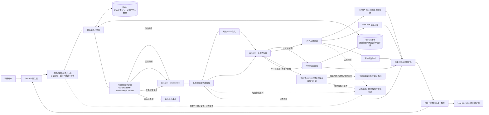
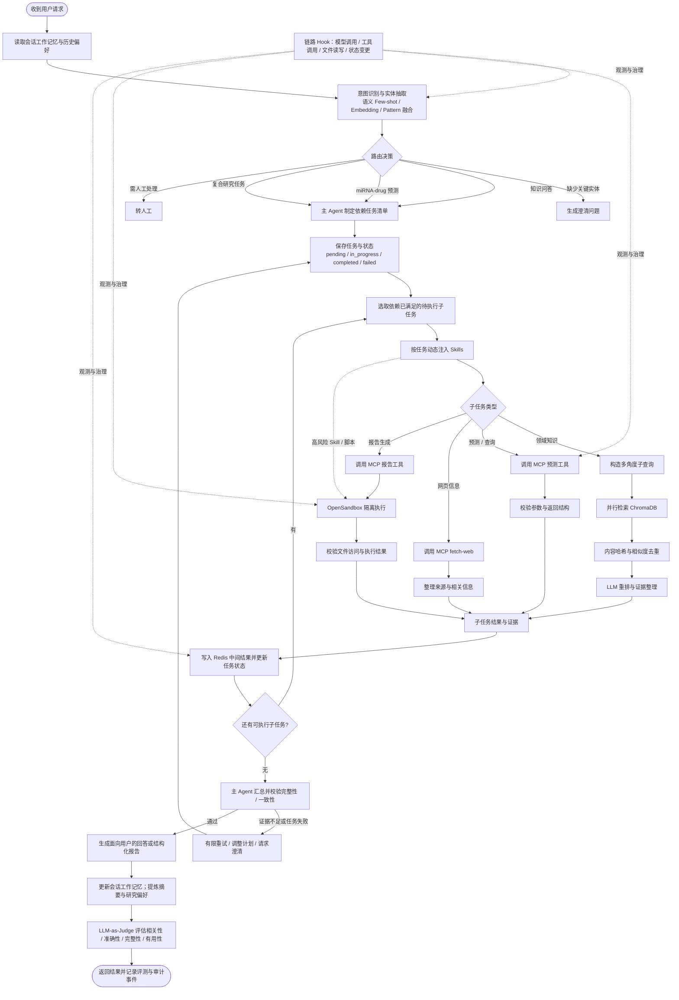
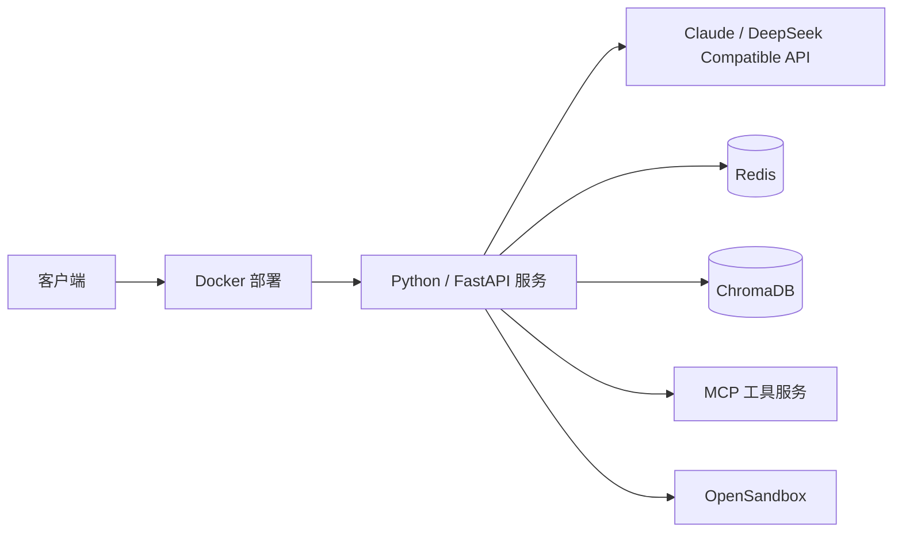

# 生物信息科研知识问答 Agent 助手

**项目角色：** 核心成员　 **时间：** 2026.03 - 2026.06  
**技术栈：** Python、FastAPI、Claude、DeepSeek Compatible API、Redis、ChromaDB、Docker

## 项目简介

面向生物信息科研场景的 LLM 知识问答与任务执行平台。系统通过细粒度意图识别和结构化主辅 Agent 路由处理知识问答、miRNA-drug 关联预测及复杂研究请求；按需检索领域知识、注入 Skills，并通过 MCP 工具执行预测、网页信息获取和测试报告生成。平台使用 Redis 与 ChromaDB 管理会话和长期语义记忆，并结合安全沙箱、链路 Hook 和 LLM-as-Judge 评测，提升执行过程的可控性与结果质量。

## 系统总览



### 架构职责

| 层级 | 核心职责 |
| --- | --- |
| 接入与安全层 | 接收用户请求，完成权限检查、敏感操作识别和审计准备 |
| 意图与路由层 | 识别用户意图、抽取实体，选择问答、预测、转人工等处理路径 |
| Agent 编排层 | 拆解任务、维护依赖、调度工具与知识检索，并汇总中间结果 |
| 知识增强层 | 对复杂查询进行拆分、改写、召回、去重和 LLM 重排 |
| 工具执行层 | 通过 MCP 调用 miRNA-drug 预测、网页信息获取和测试报告生成能力 |
| 记忆层 | 使用 Redis 管理短期工作状态，使用 ChromaDB 管理长期语义记忆和知识 |
| 执行隔离层 | 对代码脚本、文件访问和 Skill 调用进行网络、进程及文件系统隔离 |
| 观测评测层 | 在关键节点注入 Hook，并通过 LLM-as-Judge 进行端到端评测 |

## Agent 详细执行流程



## 核心模块

### 1. 细粒度意图识别

融合 LLM Few-shot 语义理解、Embedding 相似度和 Pattern 关键词匹配，对请求进行意图分类与实体抽取，覆盖知识问答、关联预测、复合任务及转人工等场景。识别结果作为 Agent 路由和任务规划的输入。

### 2. 主辅 Agent 与任务规划

主 Agent（Orchestrator）负责理解请求、规划步骤、管理依赖、汇总结果和处理失败；辅 Agent 或专项执行器负责知识检索、工具调用、信息整理和报告生成。任务清单记录依赖关系及 `pending`、`in_progress`、`completed`、`failed` 状态，支持中间结果持久化和按状态恢复。

典型复合任务链路：

```text
请求解析 -> MCP 工具调用 -> 预测结果校验 -> RAG 查询基础机制 -> 报告生成 -> 结果汇总
```

### 3. 意图触发的 RAG

仅在需要领域知识增强时触发检索。对于复杂问题，先拆分并改写为多角度子查询，再并行召回 ChromaDB 文档；随后结合内容哈希与相似度去重，并由 LLM 重排相关结果，形成供 Agent 使用的证据上下文。

### 4. MCP 工具与动态 Skills

- **miRNA-drug 工具：** 输入药物获取 Top-N miRNA 候选，或查询指定药物-miRNA 组合的关联分数。
- **fetch-web：** 获取外部网页信息，供研究问题补充参考。
- **测试报告生成：** 根据任务结果生成结构化报告。
- **动态 Skills：** 根据任务类型按需加载领域流程与提示能力，避免无关上下文进入当前任务。

### 5. 分层记忆

- **Redis 会话工作记忆：** 异步保存当前会话上下文、任务计划、状态和中间结果。
- **ChromaDB 长期语义记忆：** 保存历史对话摘要、用户研究偏好及领域知识文档，支持相似度检索。
- **非阻塞访问：** 对 ChromaDB 等同步向量库操作放入线程池执行，减少对异步请求主链路的阻塞。

### 6. 安全沙箱与链路治理

基于 OpenSandbox 构建主机与沙箱的双层文件访问平面，对网络、进程和文件系统进行隔离；代码脚本执行及高风险 Skill 调用在沙箱内运行。模型调用、工具调用、文件读写和任务状态变更等节点注入 Hook，集中处理缓存、重试、权限校验、敏感操作拦截和审计上报。

### 7. 端到端评测

通过 LLM-as-Judge 对最终回复进行相关性、准确性、完整性和有用性评估，并可用于意图识别及端到端回归检查，为提示词、检索策略和 Agent 执行流程迭代提供反馈。

## 典型请求示例

```text
用户：查询药物 X 关联度最高的 Top-10 miRNA，并说明可能的调控机制。

1. 意图识别：关联预测 + 机制知识问答
2. 实体抽取：药物 X、Top-10、调控机制
3. 任务规划：预测 -> 结果校验 -> 机制 RAG -> 汇总报告
4. MCP 调用：返回 Top-10 miRNA 及关联分数
5. RAG 检索：召回药物、miRNA 与调控机制相关文献或知识
6. 结果生成：输出排序结果、关联分数、机制证据和结果限制
7. 质量评测：通过 LLM-as-Judge 检查答案完整性与证据一致性
```

## 部署形态


